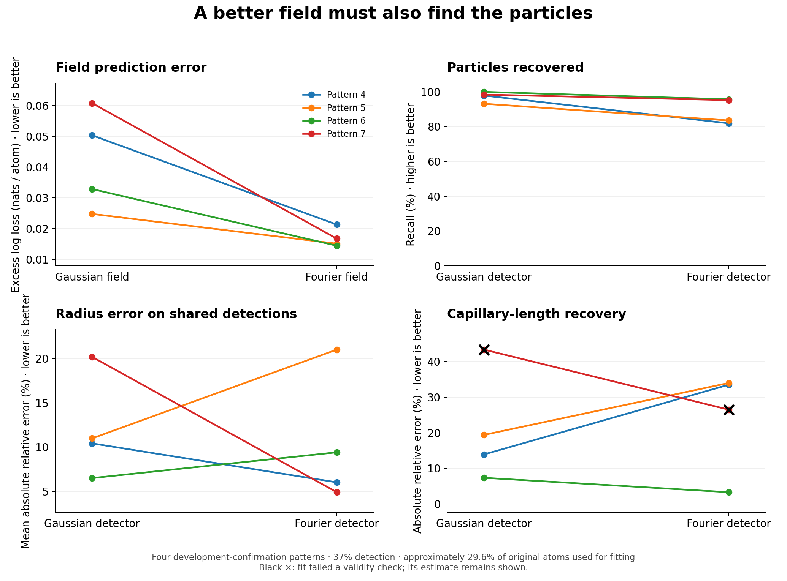

# E20 — From a Fourier field to measured precipitates

*A development pilot connecting E19's neural field to particle detection and E18's
joint geometry/physics fit. Run on the diffusion dataset at detection efficiency 0.37.*

**Outcome:** all eight development cases completed, but confirmation failed four of
the six promotion conditions. The Fourier field predicts concentrations better on
all four confirmation patterns, yet its detector misses more particles and does not
improve the joint physics fit. The reserved independent test was not run.

Implementation outline: [field-to-particle plan](../guides/field_to_particles_plan.md) ·
Fixed design: [stage4_particles_design.json](../../experiments/reconstruction/stage4_particles_design.json) ·
Runner: [stage4_particles.py](../../experiments/reconstruction/stage4_particles.py) ·
Library: [particle_detection.py](../../geom_mesh_net/fields/particle_detection.py),
[particle_physics.py](../../geom_mesh_net/fields/particle_physics.py)

## Question

E19 showed that a Fourier-feature network can estimate the solute-probability field
more accurately than smoothing. E18 showed that missing precipitates and incorrect
geometry can prevent recovery of physical constants. This experiment connects the
two: does the better field produce better particles, and do those particles improve
the same joint physics fit?

This is a transfer experiment. E19 used the original random-centre reconstruction
benchmark, whereas this pilot uses the diffusion-field simulations underlying E18.
It is also smaller than the original Stage 4 protocol. It does not establish the full
Gate 4 claim, rejection of incorrect physical laws, or applicability to measured APT.

## Fixed design and data boundaries

Four development patterns, 0–3, choose global extraction settings. Four different
development patterns, 4–7, assess that frozen choice. These confirmation patterns have
been used historically in development, including E18; they are not a pristine test
set. Patterns 74–81 are reserved for a conditional test beyond the published Stage 5.2
test scope. The runner permits their evaluation only after complete confirmation
passes every prescribed promotion condition.

The simulated detector keeps 37% of atoms. Before reading labels for fitting, the
runner reserves 20% of those observed atoms for measurement and predictive checks.
Approximately **29.6% of the original atoms** therefore enter detection and physics
fitting. An inner split of that fitting set selects the neural frequency scale and
stopping point; the selected network is then refitted on the entire fitting set.

Composition is measured from all species in detected spheres using labels held back
from fitting. If estimated spheres overlap, each atom is assigned to the sphere with
the smallest distance divided by its radius. Counts accompany every estimate; an
empty sphere has no composition estimate. Disjoint labels prevent direct fitting
leakage but do not establish statistical independence: the simulator fixes some
within-particle guest counts.

The composition target is the oracle's mean concentration inside the corresponding
true sphere. Consequently composition error includes both label noise and geometry
error. Removed atoms, true geometry, and physical constants never initialize a fit
or choose a neural checkpoint. True geometry is used only for calibration of global
detector settings and subsequent evaluation.

## Five particle detectors

| Method | Definition |
| --- | --- |
| Legacy B1 | Existing Gaussian-count significance detector |
| B1 + generic extraction | Gaussian field, absolute threshold, connected regions and peak splitting |
| Fourier + generic extraction | Fourier field with exactly the same extraction implementation |
| DBSCAN | Connected core solute atoms, nearest-core assignment of border atoms, minimum cluster size |
| Maximum-separation connectivity | Connected solute graph at distance cutoff, followed by a minimum size cutoff |

The last method is a specified connectivity baseline, **without envelope growth or
erosion**. It should not be equated with every commercial maximum-separation workflow.
The point methods estimate a spherical radius from the solute-cloud second moment,
`R = sqrt(5 mean(|x − centre|²) / 3)`. This assumes uniform sampling within a sphere;
radial chemistry, background contamination and truncation can bias it.

Both generic field methods use a 0.5-unit grid. Above-threshold voxels form
face-connected regions. Optional local maxima split a region by nearest retained
peak; this is a geometric partition, not a watershed or a posterior over boundaries.
Volume determines an equivalent spherical radius. Boundary contacts and split
regions remain in metadata. Gaussian-count significance is not applied to the neural
field.

The calibration sweep evaluates thresholds {0.15, 0.20, 0.25, 0.30, 0.40, 0.50} and
peak distances {2.0, 3.5} for each generic field, with a minimum volume of 14.
Point methods use distance cutoffs {1.5, 2.0, 2.5}, minimum sizes {5, 10, 20}, and,
for DBSCAN, core-neighbour counts {3, 5, 8}. Every candidate is retained.

Each method selects one setting across all four calibration patterns by mean F1,
then mean precision, mean relative-radius error, and fixed candidate order. The same
rule chooses one conventional reference among legacy B1, generic B1, DBSCAN and
maximum-separation connectivity. That reference remains fixed on confirmation.

The Fourier model retains E19's 256 frequencies, four hidden layers of width 256,
frequency candidates {0.375, 0.75, 1.5, 3, 6}, learning rate 0.0001, batch size
32,768, 2,000-update cap, and validation-based early stopping/refit rule. It is fitted
separately to each pattern. Neural fitting uses MPS, as in E19; joint physics fitting
uses CPU float64 and three Torch threads. The sandbox initially reported no GPU, so
CPU preparations began first. Before any detector scores were inspected, GPU access
was confirmed outside the sandbox and the execution design was amended to MPS for
every scored field. The unscored CPU preparations are not used in the comparison.

## Measurements and physics fit

Hungarian matching first maximizes the number of eligible matches, then minimizes
normalized centre distance. A match requires the estimated centre to lie within the
true sphere. Report precision, recall, F1, missed/false detections, centre and radius
errors, composition error, and geometric split/merge diagnostics. Matching and
split/merge counts are geometric proxies, not exact segmentation topology.

Radius error is also compared on the true particles matched by both the Fourier
method and the fixed reference. This prevents a detector from appearing more accurate
merely by missing difficult particles. Raw neural and Gaussian field losses on
held-back and removed atoms provide a separate transfer diagnostic; they do not enter
detector selection or promotion.

Legacy B1, Fourier, and the fixed conventional reference initialize the **same**
joint fit. Overlaps in initial spheres are resolved by the existing rule with a
0.5-unit gap; both original and adjusted geometries are retained. The fit frees
centres, radii and physical constants and uses the existing six-segment interior
profile, width 0.3, float64 arithmetic, and two rounds of at most 100 L-BFGS iterations.
One deterministic initialization uses observed abundance and detected radii. This
bounded budget does not guarantee convergence or a global optimum.

The adapter records failures, constants/radii near bounds, overlapping fitted spheres,
and invalid **unclipped** matrix probabilities at held-back and removed positions
outside fitted spheres. A `reliable` flag means only that these checks passed. It is
not an uncertainty interval, parameter-identification test, or validation of the
physical law. Finite sampled checks do not guarantee valid probabilities everywhere.

Physical scores include errors in capillary length ℓ and screening length ξ, full
held-back/removed log loss, and removed-matrix excess log loss over the oracle. The
last score follows E18's clipped matrix extension at every true-matrix atom, even if
an atom lies inside an estimated sphere. It is a diagnostic that also enters promotion
condition 5; the full-field loss and raw-probability checks are needed to interpret it.

## Promotion rule and uncertainty

Every required pattern and method must be present without a run error. Duplicates,
missing cases and missing methods make the result incomplete. Failed physical fits
remain in the report and cannot disappear from promotion denominators.

Against the calibration-selected reference, Fourier must satisfy all six conditions:

1. Improve F1 on at least three of four confirmation patterns.
2. Have a median paired precision difference of at least −0.02.
3. Have a negative median paired radius-error difference on commonly matched particles.
4. Have a negative median paired absolute-relative-capillary-error difference.
5. Have a nonpositive median paired matrix-excess-loss difference.
6. Pass the adapter's reliability checks on all four confirmation fits.

These are pilot promotion conditions, not significance tests or the original Gate 4.
The report includes exploratory intervals from 2,000 paired resamples of patterns.
With only four confirmation patterns, these intervals describe a small pilot and
cannot establish broad applicability. A failed result applies to this configuration;
it does not rule out neural-field particle detection in general.

## Calibration results: patterns 0–3

All four MPS calibration cases completed. Independently recomputing the prescribed
selection from every stored candidate reproduced the frozen settings and reference.
The [current calibration report](../../experiments/reconstruction/results/stage4_particles_calibration.json)
retains the complete sweep. Its settings, candidate scores, fitting checks, and field
metadata exactly match the [archived version 2 report](../../experiments/reconstruction/results/stage4_particles_v2_device_failure/stage4_particles_calibration.json).
The version 3 diagnostic-device repair therefore changes none of this calibration
evidence. Recorded source, design, input, runtime, and provenance identities were
checked against the completed run.

| Method | Selected setting | Mean F1 | Mean precision | Mean relative radius error |
| --- | --- | ---: | ---: | ---: |
| Legacy B1 | Existing significance settings | 0.9190 | 0.9793 | 9.78% |
| B1 + generic extraction | Threshold 0.30; peak distance 2.0 | 0.9120 | 0.9545 | 15.25% |
| Fourier + generic extraction | Threshold 0.40; peak distance 2.0 | 0.8546 | 0.9255 | 14.94% |
| DBSCAN | Distance 2.0; core count 5; minimum size 10 | 0.9027 | 0.9355 | 11.54% |
| Maximum-separation connectivity | Distance 2.0; minimum size 10 | 0.8309 | 0.8072 | 11.81% |

Both generic field settings retain the minimum volume of 14. Each column averages
the four per-pattern scores, giving patterns equal weight. The radius column first
averages absolute relative radius error over each method's matched particles. It
does not penalize missed particles and does not compare a common matched subset;
the confirmation comparison reports that separate measurement.

Legacy B1 is the calibration-selected conventional reference. Consequently the
downstream comparison needs two distinct initializations of the same joint fitter:
legacy B1 and Fourier. The selected Fourier detector has lower F1 than legacy B1 on
each of the four calibration patterns, and its mean precision is also lower. These
results do not support assuming that E19's field advantage automatically improves
particle detection on the diffusion dataset.

This is parameter-selection evidence from four development patterns. The tuned
scores are not independent estimates of generalization, and no physical-parameter
improvement follows from this table. Settings remain fixed for the prescribed
confirmation; calibration results alone neither pass nor fail its promotion rule.

## Confirmation results: patterns 4–7

The [complete confirmation report](../../experiments/reconstruction/results/stage4_particles_confirmation.json)
contains all four required patterns, all five detectors, and both prescribed physics
fits per pattern. There are no missing cases, duplicates, unexpected methods, or
version 3 run errors. Physical invalidity is recorded separately and remains in every
summary and promotion denominator.



### Better concentration predictions did not produce better detection

The Fourier field has lower log loss than B1 on both held-back and removed atoms in
all four patterns. Its improvement in concentration prediction therefore transfers
to these diffusion simulations. The selected particle detector nevertheless has
lower F1 than the existing significance detector in all four patterns.

| Pattern | Removed-field excess, B1 | Removed-field excess, Fourier | Detection F1, legacy B1 | Detection F1, Fourier | Common-particle radius error, B1 | Common-particle radius error, Fourier |
| --- | ---: | ---: | ---: | ---: | ---: | ---: |
| 4 | 0.050351 | 0.021341 | 0.9787 | 0.8851 | 10.41% | 6.01% |
| 5 | 0.024799 | 0.015132 | 0.9577 | 0.9037 | 10.98% | 21.00% |
| 6 | 0.032880 | 0.014468 | 1.0000 | 0.9437 | 6.50% | 9.40% |
| 7 | 0.060804 | 0.016765 | 0.9841 | 0.9677 | 20.18% | 4.90% |

Field excess is log loss minus oracle log loss, in nats per removed atom; it is
measured before any joint physics fit. Common-particle radius errors are mean
absolute relative errors on the same matched true particles, respectively 77, 60,
67, and 60 particles in the four patterns.

The five-detector comparison is:

| Method | Median F1 | Median precision | Median recall | Median relative radius error | Missed particles | False detections |
| --- | ---: | ---: | ---: | ---: | ---: | ---: |
| Legacy B1 | 0.9814 | 0.9848 | 0.9814 | 11.31% | 8 | 4 |
| B1 + generic extraction | 0.9247 | 0.9511 | 0.9814 | 11.37% | 26 | 26 |
| Fourier + generic extraction | 0.9237 | 0.9731 | 0.8940 | 7.71% | 35 | 10 |
| DBSCAN | 0.9362 | 0.9432 | 0.9125 | 8.20% | 25 | 13 |
| Maximum-separation connectivity | 0.8550 | 0.8406 | 0.9095 | 16.51% | 30 | 64 |

The score columns are medians over four patterns, whereas missed and false detections
are totals. There are 300 true particles. Radius error in this summary uses each
method's own matched set. Its apparently larger advantage for Fourier should not be
confused with the paired comparison: the median radius-error difference on commonly
matched particles is only −0.007445, an improvement of **0.745 percentage points**.
Fourier improves that paired measurement in two patterns and worsens it in two.

Median absolute composition error is 13.77 percentage points for Fourier and 16.77
for legacy B1. Those are descriptive measurements within their respective detected
spheres; they include boundary error and counting noise and do not establish
calibrated composition inference.

### The downstream physics comparison also fails

All entries below are retained, including the two invalid pattern 7 fits. Within each
paired cell, the order is **legacy B1 / Fourier**. Absolute parameter errors are
relative to the known simulated value.

| Pattern | Absolute ℓ error | Absolute ξ error | Removed-matrix excess loss, nats/atom | Validity checks |
| --- | ---: | ---: | ---: | --- |
| 4 | 13.91% / 33.47% | 27.60% / 38.71% | 0.00016678 / 0.00054936 | Both passed |
| 5 | 19.39% / 33.96% | 0.58% / 20.18% | 0.00009179 / 0.00023392 | Both passed |
| 6 | 7.37% / 3.32% | 8.18% / 35.26% | 0.00004445 / 0.00035428 | Both passed |
| 7 | 43.33% / 26.49% | 76.40% / 93.84% | 0.00153883 / 0.00316636 | Both failed |

Across all four cases, median absolute ℓ error is 16.65% for legacy B1 and 29.98% for
Fourier; median absolute ξ error is 17.89% and 36.99%, respectively. The Fourier
initialization also gives worse full-field removed-atom log loss and worse matrix
excess loss in every pattern. These medians describe the recorded outputs, including
invalid fits, and must not be read as evidence of reliable parameter recovery.

On pattern 7, legacy B1's fit has two overlapping sphere pairs, with minimum surface
gap −1.31448. Fourier's fit has one overlapping pair, with minimum gap −0.001279, and
ξ reaches its lower search bound. The recorded flags are `invalid_fitted_geometry`
for legacy B1 and both `invalid_fitted_geometry` and `physical_constant_at_bound` for
Fourier. Neither invalid solution was removed or replaced. Both nevertheless pass
the sampled probability-range check, demonstrating why that check alone cannot
establish physical validity.

### Exact promotion decision

Recomputing the decision from the individual cases reproduces the saved verdict:
**complete, failed**. Differences below are Fourier minus the fixed legacy-B1
reference and use the prescribed median of per-pattern differences.

| Condition | Measured | Required | Result |
| --- | ---: | ---: | --- |
| Detection F1 wins | 0 of 4 | At least 3 of 4 | Failed |
| Median precision difference | −0.00892984 | At least −0.02 | Passed |
| Median common-particle radius-error difference | −0.00744501 | Below 0 | Passed |
| Median absolute-relative-ℓ-error difference | +0.05261682 | Below 0 | Failed |
| Median matrix-excess-loss difference | +0.0003462085 nats/atom | At most 0 | Failed |
| Fourier fits passing all validity checks | 3 of 4 | 4 of 4 | Failed |

The paired parameter-error difference is not the difference between the two marginal
medians reported above. The runner uses the paired quantity in this table. Its failed
decision prevents access to the reserved patterns 74–81; no independent test result
is claimed.

The exploratory 95% pattern-bootstrap interval for the F1 difference is
[−0.09367, −0.01639]. For common-particle radius error it is [−0.15282, +0.10025],
and for absolute relative ℓ error it is [−0.16841, +0.19552]. These four-pattern
intervals expose substantial uncertainty in geometry and parameter comparisons;
they are not a replacement for the reserved independent evaluation.

### Failure diagnosis and what this result supports

An exploratory check after the decision examined the saved neural grid inside each
true sphere, using the detector's valid-voxel mask and its fixed threshold of 0.40.
Of the 35 missed particles, 29 have no interior grid value above that threshold;
their peaks range from 0.0603 to 0.1432, below even the sweep's lowest threshold of
0.15. Four more have an above-threshold peak but less than 14 volume units of
above-threshold voxels inside the true sphere. The remaining two have at least that
amount of interior support and are still missed. No settings were changed in response.

Missed particles have median true radius 2.45, compared with 3.92 for detected
particles. This is consistent with a field that predicts the overall concentration
well while losing some smaller objects. It does not establish a unique cause: the
measured interior support differs from the full segmentation-component volume, and
the association between missed particles and physics errors is not a controlled
causal comparison.

The result supports keeping the existing significance detector as the current
reference. It does not support substituting the tested Fourier threshold detector
into the physics pipeline. A subsequent experiment should first enforce the solver's
separated-sphere assumption during fitting, then compare Gaussian and Fourier
boundary estimates using the same Gaussian-detected particle candidates. Holding
the candidate list fixed would separate boundary refinement from missed-particle
effects. Recovering additional small-particle candidates is a distinct question.
These are new designs requiring fresh confirmation evidence; this run does not tune
around its failed result.

The remaining limits are four historically used development-confirmation patterns,
one detection efficiency, spherical simulated precipitates, simplified point-method
comparators, and a bounded single-start optimizer. No uncertainty calibration,
physical-law discrimination, real-data validity, or full Stage 4 claim follows.

Recorded preparation of the eight scored fields totals **2,130.21 seconds
(35.5 minutes)**, and the eight joint physics fits total **448.06 seconds
(7.5 minutes)**. These are summed component wall times, counting reused fields once;
they are not the elapsed duration of a single uninterrupted command. They exclude
unused CPU preparations, the archived device failure, and reporting overhead.

## Reproduction and saved evidence

**Historical source snapshot:** commit `0c08355235fb9b50b46432fccca0d06afc1568bc`
preserves the complete E20 implementation, reports and design before the
29 October 2026 merge preparation. All 11 source hashes in both version 3 reports
match that commit. The later Stage 5 gate and particle-growth repairs change
fingerprinted source files; they do not retroactively change this experiment or
its failed verdict. The current runner therefore correctly refuses to resume these
reports with the changed source. Use the preserved commit in a separate checkout
for historical reproduction, with the recorded data, artifacts and environment.
Do not rewrite the saved hashes to bypass that check. New experiments require
their own output directory and provenance.

Version 3 repairs a device-placement error in the diagnostic scorer: a reloaded
checkpoint must move to MPS before prediction on MPS inputs. Version 2 recorded a
confirmation error on pattern 4 at that step, before producing detector or physics
scores. Its [failed confirmation report](../../experiments/reconstruction/results/stage4_particles_v2_device_failure/stage4_particles_confirmation.json),
calibration report, exact runner source and design are retained in the same archive.
The repair changes no neural training, detector setting, physics setting or promotion
condition. Version 3 reuses the identical saved fields, recomputes calibration, and
evaluates every required confirmation pattern. A regression test checks that device
placement occurs before either prediction subset is scored.

From the preserved checkout's root, with the existing diffusion dataset and its
oracle cache:

```bash
python -m experiments.reconstruction.stage4_particles --phase calibration
python -m experiments.reconstruction.stage4_particles --phase confirmation
python -m experiments.reconstruction.stage4_particles --phase test
```

The last command refuses an incomplete or failed confirmation. Alternatively,
`--phase run` executes calibration, confirmation, and the test only if promoted.
`--patterns` can resume a subset of an explicit phase without reducing that phase's
required scope. The supplied design requires MPS access and fixes CPU execution to
three threads. An environment without MPS needs a separately recorded CPU design;
changing the device invalidates existing report provenance.

Recreate the comparison figure from the complete saved confirmation report without
refitting any model:

```bash
python -m experiments.reconstruction.plot_stage4_particles
```

Compact reports live in `experiments/reconstruction/results/stage4_particles_*.json`.
Large model checkpoints and grids live in ignored `stage4_artifacts/` below that
directory. Dataset, oracle, split, fitting-input, source, runtime and design identities
are recorded. Incompatible reports are refused; use a new output directory for a
changed protocol. Cached grids and weights are checked against exact artifact hashes.
The checkpoint loader reconstructs the network from its architecture and tensors.

Confirmation detector scores are not inspected until global settings are frozen.
One runner writes each report, saving each completed case so a compatible run can
resume.

Historical verification after completion: **326 tests passed in 146.30 seconds**, including
the held-label isolation, completeness, promotion, checkpoint, and diagnostic-device
regressions. The six promotion conditions and five detector summaries were
independently recomputed from individual results. At completion, the recorded source, data,
oracle, runtime, design, and report fingerprints were checked; version 3 calibration
exactly reproduces version 2's settings, scores, and field metadata.

The provenance records an explicit list of implementation files, not every transitive
dependency or a complete environment lock. Future changes to omitted helpers such
as the generator's thinning constants or the oracle loader require a new experiment
version and should extend that list. No such changes were made during this run.
