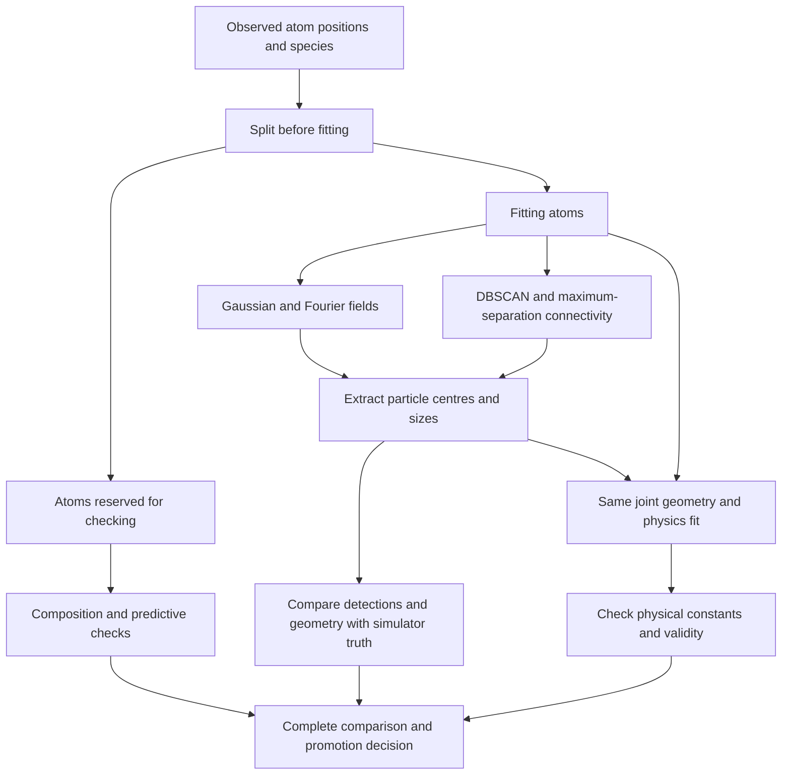

# From the neural field to measured precipitates

Implementation and experiment outline, 15 October 2026.

## Objective

Determine whether the Fourier-feature field demonstrated in E19 finds precipitates and
measures their geometry better than smoothing, and whether that improves the existing
joint geometry/physics fit. The deliverable is a reusable extraction/measurement API,
a reproducible experiment runner, saved development results, and a walkthrough of the
outcome. A negative result is a valid outcome; an improved field score is not evidence
of improved particle measurements.

## 1. Scope and data boundaries

- First study: the existing **diffusion-field simulations**, at detection efficiency
  0.37. This deliberately tests whether E19's method works on the different dataset
  used by the physics experiment.
- Calibration patterns: 0, 1, 2, 3. Their simulated geometry may choose global detector
  settings. Their removed labels may report diagnostic scores, not train a field.
- Development confirmation: 4, 5, 6, 7. No detector setting may change after their
  scores are inspected. These are development patterns, not a new independent test.
- Conditional test reservation: 74 through 81, beyond the published Stage 5.2 test
  scope. Run only after the confirmation decision permits it and a design is frozen.
  Test access must not silently follow a failed pilot. The runner will make this
  condition explicit.
- Use Stage 5's existing reproducible thinning and acceptance split. Reserve 20% of
  observed atoms before any label-dependent preparation. Split the remaining 80%
  internally for neural early stopping, then refit on that 80% only.
- All detector methods receive the same fitting atoms, approximately 29.6% of the
  original atoms after the additional holdout. The acceptance atoms provide
  composition measurements and predictive checks held back from fitting. Removed atoms and
  simulator truth are scoring information only.
- Record dataset content hashes, split hashes, source hashes, complete settings,
  fixed thread count, and model architecture. Reject incompatible resumed artifacts.

## 2. Extraction and measurement library

Add `geom_mesh_net.fields.particle_detection`:

1. A serializable particle geometry object with centres, radii, and provenance.
2. Extraction from a regular probability grid using an absolute concentration
   threshold, minimum volume, and optional peak separation. Mark boundary-touching
   regions and split regions. Express grid distances in physical coordinate units.
3. A Gaussian field and a neural field use the same extraction implementation.
   Do not apply the Gaussian-count variance formula to neural predictions.
4. A SciPy-based DBSCAN implementation, and a maximum-separation **connectivity**
   baseline with a minimum component size. The latter does not include commercial
   envelope/erosion steps and must be labelled as such in every scientific comparison.
5. Estimate point-cluster radii using a documented second-moment convention. Report
   that solute-centred sampling can bias this radius; do not equate it with a fully
   corrected conventional APT measurement.
6. Measure observed composition using all species in detected spheres, with an
   explicit assignment rule for overlaps and counts accompanying every estimate.

Truth scoring must include precision, recall, F1, missed/false detections, matched
centre and radius errors, and explicit split/merge diagnostics. Report counts along
with errors: detecting only easy particles must not appear to improve size accuracy.
Compare radius errors on the true particles matched by both methods as well as on
each method's own matched set. Composition scoring uses held-back labels.

## 3. Fair detector comparison

Evaluate five methods:

- the existing B1 Gaussian/significance detector, unchanged;
- B1 Gaussian field with the new generic extraction;
- the Fourier field with exactly that generic extraction;
- DBSCAN on fitting solute atoms;
- maximum-separation connectivity on fitting solute atoms.

Reuse E19's frozen Fourier architecture, frequency candidates, learning rate, early
stopping, and refit rule. Fit each pattern independently. Choose global extraction
parameters on calibration patterns by mean particle F1; break ties by precision,
matched radius error, then deterministic candidate order. Use the same objective for
every tuned method. Save every candidate score and the selected settings. Select a
single conventional reference globally on calibration data, never separately on each
confirmation or test pattern.

The execution plan was amended before any detector scores were inspected: use MPS
for every scored neural field. The sandbox initially hid the GPU, so CPU preparation
began first. After GPU access was confirmed, those unscored preparations were set
aside. Physics fits remain CPU float64 with three threads. This amendment changes
the device, not the model, data split, candidate grid or promotion conditions.

Save the trained Fourier model and predicted grid so extraction sweeps do not require
retraining. Keep large checkpoints/grids in the existing ignored results-artifact
area; retain compact JSON results in version control. Every cached artifact needs a
matching design, source, and dataset fingerprint.

## 4. Connect detections to the joint physics model

Add `geom_mesh_net.fields.particle_physics`, a wrapper around the existing joint fit.
Apply the same fit settings and fitting atoms to the existing detector, the Fourier
detector, and the globally selected conventional reference. The pilot uses CPU
float64, three threads, one fixed initialization, six interior-profile segments,
free centres, width 0.3, and 100 L-BFGS iterations in each of two rounds. This is a
bounded development fit; report convergence limitations and do not call it a global
optimum or a calibrated posterior.

Resolve initial sphere overlaps by the existing documented rule and retain both raw
and adjusted geometry. Record errors from both so overlap repair cannot silently
improve the reported detector. Refuse an empty or invalid initial geometry. Diagnose
fitted overlap, nonfinite values, constants at bounds, and invalid **unclipped**
matrix probabilities. Clipped probabilities or a low training loss must not conceal
an invalid physical solution. Keep all failed/unreliable cases in the report.

Scores: relative error of capillary and screening lengths, held-back and removed-atom
log loss, excess matrix log loss over the simulated oracle, post-fit geometry errors,
and reliability/failure frequency. Oracle geometry and concentrations are never used
to initialize or select a fit.

Also score the unfettered Fourier and Gaussian fields on held-back and removed atoms.
This diagnostic distinguishes field-transfer failure from particle-extraction failure;
it does not select detectors or enter the promotion decision. The matrix-excess score
uses the prior experiment's clipped matrix extension, including true-matrix atoms
inside estimated spheres; report full-field loss and physical-validity flags alongside it.

## 5. Pilot decision and independent evaluation

The runner must require every prescribed pattern/method result, unique identities,
matching fingerprints, and no unreported errors before issuing a complete verdict.
Incomplete runs remain `incomplete`, never passed. Development settings are frozen
after calibration. Confirmation may support a decision, not new tuning.

Advance to the reserved independent test only if, against the globally selected
conventional reference, the Fourier method:

1. improves detection F1 on at least three of four confirmation patterns;
2. has a median paired detection-precision difference of at least −0.02;
3. has a negative median paired radius-error difference on particles both methods detect;
4. has a negative median paired absolute-relative-capillary-error difference;
5. has a nonpositive median paired removed-matrix excess-loss difference;
6. has no failed or physically invalid confirmation fit.

These are development promotion conditions, not significance tests. Report uncertainty
over patterns and all individual results; four confirmation patterns cannot establish
broad applicability. If the pilot does not advance, finish the implementation and
record the failed conditions without inspecting reserved test outcomes. Further
algorithm changes require a new experiment version and new confirmation evidence.

An independent run uses the frozen method and reports all eight reserved patterns.
It must retain the same completeness and physical-validity checks. This study does
not establish rejection of incorrect physical laws; that requires the alternative
field controls in a separately specified Stage 5.3 study.

## 6. Verification and documentation

- Unit tests: extraction geometry, disconnected and touching particles, empty input,
  invalid grids, density connectivity, DBSCAN border/noise behavior, matching,
  composition assignment, and diagnostics.
- Harness tests: splits before label access, global calibration choices, deterministic
  tie breaking, fresh-test access rules, completeness/duplicates/errors, source and
  dataset provenance, resume rejection, and checkpoint round trips.
- Physics adapter tests: no-particle handling, finite checks, invalid sphere overlap,
  unclipped field checks, and training-only selection.
- Run the relevant tests, then the full suite. Run the actual calibration and
  confirmation experiments; retain their results even when the hypothesis fails.
- Add E20 with the fixed design, comparison tables, runtime, failure analysis,
  reproducible commands, and limits. Update the project roadmap and README to reflect
  what was actually measured. Do not describe a proposed experiment as completed.

## Completion criteria

The work is complete when the library and runner are usable, tests pass, all required
development cases are recorded, and the outcome is documented. A positive confirmation
also requires the reserved evaluation; a negative confirmation explicitly stops that
evaluation and identifies the next scientific obstacle. Neither outcome establishes
real-data validity or uncertainty calibration of the fitted physical constants.

## Completed outcome

The library, comparison runner, checkpoint cache, validity diagnostics and regression
tests are implemented; the full suite passes all 326 tests. All four calibration and
four confirmation patterns completed.
The frozen Fourier detector failed promotion, so the reserved test was not evaluated.
The complete measurements, retained invalid fits, execution amendments and next
scientific question are recorded in [E20](../experiments/E20_field_to_particles.md).
